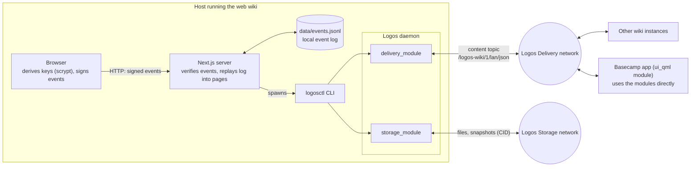

# Logos Wiki

A MediaWiki-compatible wiki (Vector 2022 skin, wikitext, history, diffs, special pages) whose data lives on the [Logos](https://logos.co) stack.

- Every change is an ed25519-signed event. A page's history is derived by replaying the event log.
- Accounts are keypairs derived in the browser from name and password with scrypt. The server never sees the password.
- Logos Storage holds uploaded files and periodic snapshots of the event log.
- Logos Delivery relays new events and snapshot announcements between instances on a shared content topic.
- Anyone can create an account and edit their own user pages. The admin decides who may edit everything else at `Special:TrustedEditors`.

## Architecture

There are two clients over one signed event log. The web wiki is a Node.js (Next.js) server you host; it is not a Logos module and drives a local Logos daemon. The Basecamp app is a Logos `ui_qml` module (`basecamp/metadata.json`) that depends on `storage_module` and `delivery_module`.



- **Event log is the source of truth.** Every change is an ed25519-signed event. The server verifies each event, appends it to `WIKI_DATA/events.jsonl` and rebuilds page state by replaying the log.
- **The web server needs a local Logos daemon.** The Node process has no Logos library. It runs `logosctl` (`LOGOSCTL`) to call `storage_module` and `delivery_module` in the daemon on the same machine. `install.sh` installs and starts both.
- **Delivery relays events.** Accepted events and snapshot announcements are published on `WIKI_TOPIC`. Instances sharing a topic share a wiki.
- **Storage holds files and snapshots.** Uploads are stored by CID. Every 15 minutes, if the log changed, the server uploads a snapshot of the log and announces its CID on the topic. Other instances (or `WIKI_SNAPSHOT_CID` on first start) download it and replay it.
- **Without the daemon** (`LOGOS_DISABLED=1`) the wiki runs from the local log only: no sync, no snapshots, no file uploads.
- **Basecamp** has no Node server and no `logosctl`. The `ui_qml` module calls the Delivery and Storage modules inside Basecamp and replays the same log. The JS in it (`qml/wiki.js`) is bundled from `basecamp/js` by esbuild. See [basecamp/README.md](basecamp/README.md).

## Install

Requirements: Linux (x86_64 or arm64) or macOS (Apple Silicon), git, Node.js 22.6+.

```sh
curl -fsSL https://raw.githubusercontent.com/uNexpectedR/Logos-Wiki/main/install.sh | sh
```

[`install.sh`](install.sh) installs `logosctl` 0.3.2 from the [official release](https://github.com/logos-co/logos-logoscore-cli/releases/tag/0.3.2) and the tested Storage and Delivery module packages (all SHA-256 checked), starts the Logos daemon, clones this repo to `~/logos-wiki`, asks for the admin name and password, builds, and starts the wiki on http://localhost:3000. Read it first if you prefer: `curl -fsSL <url> -o install.sh && less install.sh && sh install.sh`.

On a server, `LOGOS_WIKI_SERVICE=1` installs a systemd user service instead of running in the foreground. Rerunning the script updates the app and keeps the admin key in `~/logos-wiki/.env.local`.

## Run manually

```sh
npm install
npm run admin-key                 # prompts for the admin name and password, prints WIKI_ADMIN_KEY
export WIKI_ADMIN_KEY=<key>
logosctl daemon start -d
npm run build && npm start        # http://localhost:3000
npm run import                    # optional: copy pages, history and files from the source wiki, signed as the admin
```

Then log in with the same admin name and password. Without the daemon, set `LOGOS_DISABLED=1`; the wiki then runs from the local event log only.

## Configuration

| Variable | Default | Purpose |
| --- | --- | --- |
| `WIKI_ADMIN_KEY` | none | Admin public key (hex) |
| `WIKI_SITENAME` | `Local Area Network` | Site name |
| `WIKI_DATA` | `./data` | Event log, snapshot pointer, file cache |
| `WIKI_TOPIC` | `/logos-wiki/1/lan/json` | Delivery content topic shared by instances |
| `WIKI_SNAPSHOT_CID` | none | Bootstrap a new instance from a Storage snapshot |
| `WIKI_SERVER` | `http://localhost:3000` | Target of `npm run import` |
| `LOGOS_PRESET` | `logos.dev` | Delivery network preset |
| `LOGOS_DISABLED` | unset | `1` disables Storage and Delivery |
| `LOGOSCTL` | `logosctl` | Path to the Logos CLI |

## Develop

```sh
npm test
npm run lint
npx tsc --noEmit
```

## Basecamp

A native QML app lives in [`basecamp/`](basecamp/). In Basecamp 0.3.2 Package Manager, add repository:

```
https://raw.githubusercontent.com/uNexpectedR/Logos-Wiki/main/basecamp/logos-repo.json
```

then install **Logos Wiki**. The app ships the imported LAN snapshot, so Main Page has content on first open. See [basecamp/README.md](basecamp/README.md) for the local `.lgx` fallback and how to pack a release.

## License

Apache-2.0. The skin assets are third-party; see [NOTICE](NOTICE).
